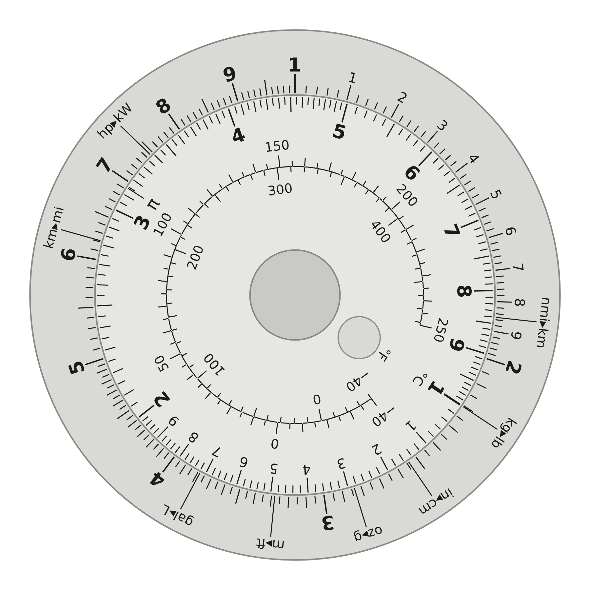
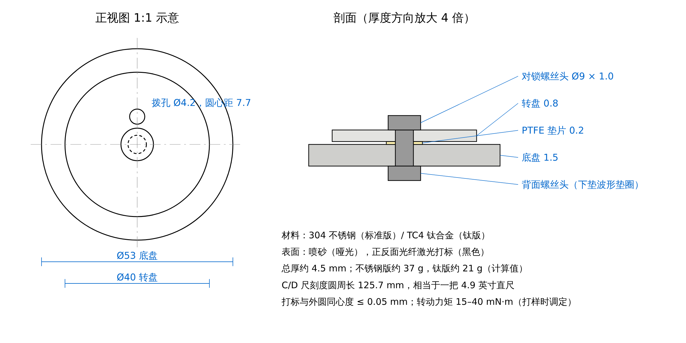

# 01 · 产品定义

## 一句话

**DECADE：把一把 5 英寸计算尺卷成一枚 53 毫米的金属圆盘。** 不用电、不用 App，转一下就能做乘除、单位换算、百分比和摄氏华氏互查。

名字的来历：计算尺的刻度从 1 到 10 正好是一个「十倍程」（decade），在圆盘上首尾相接绕成一圈。

*线稿示意图，由生产图稿直接渲染，不是实物照片。图中转盘的「1」对准了底盘的 kg▸lb 标记：此时转盘上的每个数是公斤，正对着的底盘读数就是磅。*

## 为什么选它

选品时我用了五条硬标准，它全部满足：

| 标准 | DECADE 的情况 |
|---|---|
| 不带电 | 没有电池和电路，不需要任何电子类认证，也没有电池运输限制 |
| 不开模 | 激光切割 + 激光打标，打样和量产是同一套工艺，首批几百件就能做 |
| 又小又轻 | 约 37 克，厚 4.5 毫米，能按小包寄出 |
| 国内供应链成熟 | 钣金切割、光纤打标、对锁螺丝都是珠三角、长三角的通用加工 |
| 核心价值我能直接交付 | 产品的灵魂是刻度，刻度是数学。图稿由代码精确生成，已经在 `artwork/` 里 |

还有两条市场上的理由：

- **受众明确**：工程师、数学和物理爱好者、EDC（随身小物）玩家、飞行员和航海爱好者、喜欢「模拟工具」的人。这些人恰好是 Kickstarter 设计类目的主力支持者。
- **相邻品类已被验证**：金属尺、钛合金量具类项目在 Kickstarter 上反复成功（例如 2025 年一个钛卷尺 + 圆规尺项目筹到约 38 万美元）。

**需要你知道的不利事实**：我没有搜到「圆形计算尺」本身的众筹先例。这意味着竞争少，也意味着需求没有被直接验证过。所以方案里把目标金额定得很低，并且在上线前安排了预热期来测需求——预热数据不好就不上线，损失只有打样钱。

## 它能做什么

| 功能 | 怎么用 | 例子 |
|---|---|---|
| 乘法 | 转盘的 1 对准底盘的 a，在转盘上找 b，读对面的底盘 | 1.5 × 4 = 6 |
| 除法 | 转盘的 b 对准底盘的 a，读转盘 1 对面的底盘 | 9 ÷ 6 = 1.5 |
| 单位换算 | 转盘的 1 对准底盘上的换算标记，整圈同时成立 | 对准 kg▸lb：70 kg → 154 lb |
| 百分比、小费、折扣 | 转盘的 1 对准 1.2 就是加 20%，对准 8 就是打八折 | 85 的 1.2 倍 = 102 |
| 等比缩放 | 设一次比例，整圈都是这个比例 | 菜谱翻 1.5 倍、地图比例尺、汇率 |
| 摄氏 ⇄ 华氏 | 转盘内圈的对照尺，不用转，直接对读 | 180°C ≈ 356°F |
| 圆周率 | 转盘上有 π 标记 | 直径 × π = 周长 |

底盘上的 8 个换算标记：`km▸mi`、`kg▸lb`、`in▸cm`、`m▸ft`、`oz▸g`、`gal▸L`、`nmi▸km`、`hp▸kW`。每个都能双向使用。

**精度**：计算尺读数是三位有效数字左右，典型误差 0.5%–1%。它是估算工具，不是计算器的替代品——宣传时必须这么说，不能夸大。

## 规格

| 项目 | 数值 |
|---|---|
| 底盘 | Ø53 × 1.5 mm |
| 转盘 | Ø40 × 0.8 mm，带一个 Ø4.2 拨孔 |
| 总厚 | 约 4.5 mm（含螺丝头） |
| 重量 | 不锈钢版约 37 g，钛版约 21 g（计算值，以样品称重为准） |
| 刻度长度 | 125.7 mm（相当于 4.9 英寸直尺） |
| 最小刻线间距 | 0.55 mm |
| 材料 | 304 不锈钢 / TC4（Ti-6Al-4V）钛合金 |
| 表面 | 喷砂哑光，光纤激光黑色打标 |
| 轴 | Ø5 对锁螺丝 + PTFE 垫片 + 波形垫圈 |

## 两个版本

- **不锈钢版**：主力款，定价低，手感沉。
- **钛合金版**：高价款，轻一半，EDC 玩家偏爱钛。两个版本共用同一套图稿和工艺，只换板材。

加购件：**植鞣革皮套**（保护刻度，也提高客单价）。

## 还没验证、必须靠打样确认的事

我做的是设计和计算，没有做过实物。下面这些在拿到样品之前都只是设计意图：

1. **转动手感**：太松会走位，太紧转不动。靠垫片和螺丝预紧力调，目标力矩 15–40 mN·m。
2. **拨孔好不好用**：Ø4.2 的孔是否足够让指腹带动转盘。备选方案是把正面螺丝头换成带滚花的小旋钮。
3. **0.95 mm 高的小字是否清晰**：换算标记和温度数字是全盘最小的字。看不清就放大并减少标记数量（改 `generate.py` 的参数即可）。
4. **两盘高度差带来的视差**：转盘比底盘高约 1 mm，斜着看会有读数偏差。如果样品上明显，就把转盘减薄到 0.6 mm 或给边缘加倒角。
5. **黑色打标的耐磨和耐汗**：需要做擦拭和盐水测试（方法见 `02-manufacturing.md`）。
6. **对锁螺丝的实际尺寸**：图稿按 Ø5 筒径、Ø9 头径画的，要按买到的实物改中心孔。

## 名字与商标

DECADE 是普通英文单词，容易与已有商标冲突。上线前在美国 USPTO 和欧盟 EUIPO 的商标库里查第 9 类（计算器具）和第 16 类（文具、绘图仪器）。如果冲突，备选名：**Turnrule**、**Logdisc**、**Orbit Rule**。改名只需要改 `generate.py` 背面的一行文字。
