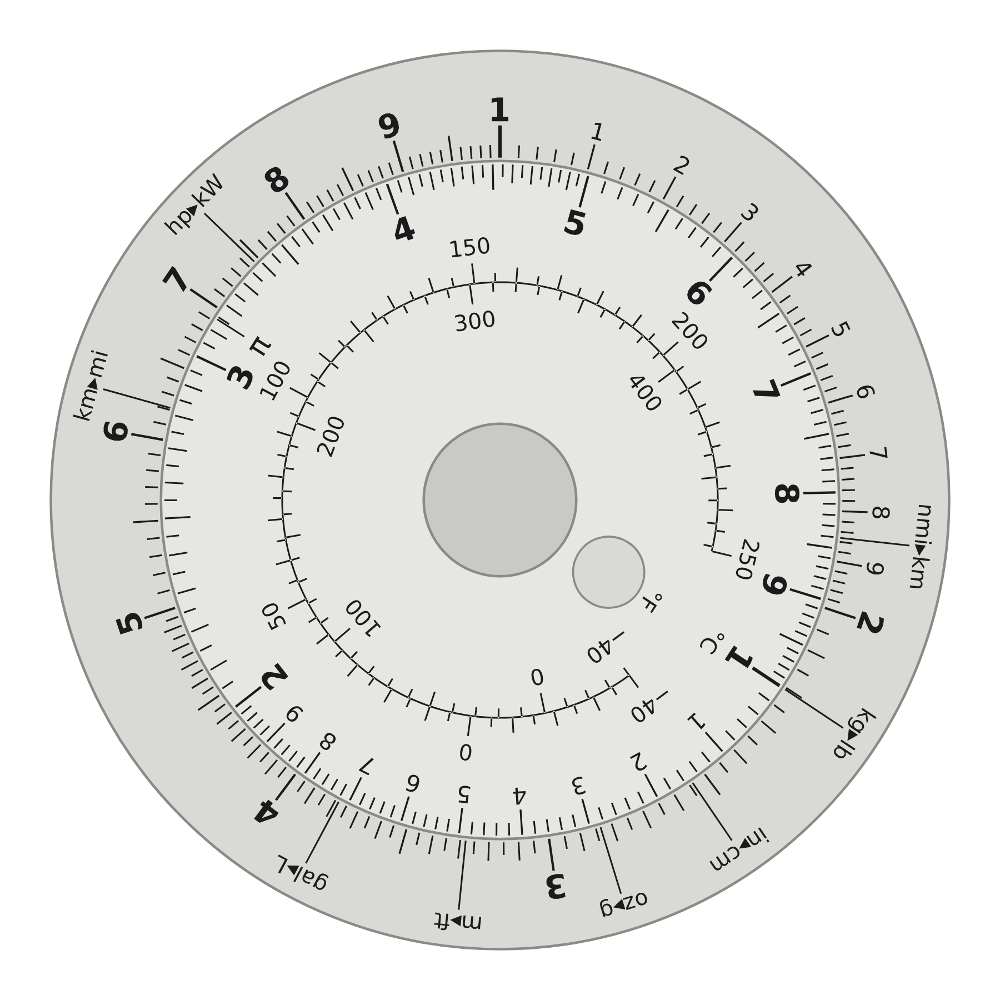

# DECADE · Kickstarter 全套方案

一枚 53 毫米的金属圆形计算尺。不用电、不开模、能按小包寄出。

## 这个文件夹里有什么

| 文件 | 内容 |
|---|---|
| [01-product.md](01-product.md) | 产品定义：做什么、为什么选它、规格、待验证的问题 |
| [02-manufacturing.md](02-manufacturing.md) | 制造流程：物料清单、工艺、检验、三轮打样、询价模板 |
| [03-finance-timeline.md](03-finance-timeline.md) | 定价、收支测算、时间表、资金安排 |
| [04-campaign-page.md](04-campaign-page.md) | Kickstarter 页面全文（英文）：标题、正文、档位、风险、FAQ、AI 披露 |
| [05-video-photo.md](05-video-photo.md) | 视频脚本、图片和动图的拍摄清单 |
| [06-marketing.md](06-marketing.md) | 预热计划、各渠道发帖草稿、邮件序列、测评邀约、更新模板 |
| [07-legal-fulfillment.md](07-legal-fulfillment.md) | 发起资格、商标、合规、发货、税，以及资料来源 |
| `artwork/` | 生产图稿（DXF + SVG）、生成脚本、预览图、工程示意图 |
| `finance.py` | 财务模型，改假设后重新运行 |

## 生产图稿

`artwork/generate.py` 用数学公式生成全部刻度，输出可以直接交给加工厂的文件：

| 文件 | 用途 |
|---|---|
| `base-front.dxf` | 底盘正面：切割轮廓 + D 尺和换算标记 |
| `base-back.dxf` | 底盘背面：使用说明和序列号 |
| `top-front.dxf` | 转盘正面：切割轮廓 + C 尺、π、温度对照尺 |
| `*.svg` | 同样内容的 SVG 版本，方便预览 |
| `preview.png` / `drawing.png` | 效果示意和工程示意图 |

DXF 里 `CUT` 图层是切割线，`MARK` 图层是打标区域，文字已全部转成轮廓。
要改尺寸、字号、换算标记，改脚本顶部的参数再运行 `python3 generate.py`（需要 `pip install matplotlib ezdxf`）。
脚本每次运行都会自检：刻度位置、换算读数、各圈文字之间的间距。

## 接下来按这个顺序做

1. **本周**：把三个 DXF 发给一家激光加工店，做第一轮 5 套样品（约 800 元）。同时在 Kickstarter 建一个草稿项目，把身份和银行验证走完（见 07）。
2. **拿到样品后**：按 01 里的 6 个待验证问题逐条检查，把结果告诉我，我来改图稿。
3. **12 月**：第二、三轮打样，要量产和物流报价，把真实数字填进 `finance.py`。
4. **1 月**：拍摄，填页面，开预热。
5. **2 月底**：看预热名单人数，决定是否上线。
6. **3 月 9 日**：上线。

## 我做了什么，没做什么

**做了并验证过的**：

- 刻度图稿：位置由公式计算，并用独立算法复核了换算读数；渲染后目视检查了排版。
- 财务测算：由脚本计算，不是手算。
- Kickstarter 发起国名单、AI 披露政策、平台费率：这次查了官方或第三方来源，链接在 07。

**只是设计意图、需要实物验证的**：

- 转动手感、拨孔是否好用、小字是否清晰、视差是否明显、标记是否耐磨。这些只有样品能回答。
- 所有成本和运费。都是估算，没有问过任何一家供应商。

**不确定的**：

- 需求。没有找到圆形计算尺的众筹先例，筹款额我无法预测。方案用低目标金额和预热期决策点来控制损失。
- 澳大利亚驾照和你的银行账户能否通过 Kickstarter 的验证，建草稿项目时就能知道。
- 美国对中国小包裹的现行税率，各来源说法不一致。

**需要你本人做的**：打样、拍摄、对外发帖、完成 Kickstarter 验证、收款。页面上方括号里的内容要用真实信息替换，没测过的不要写。
